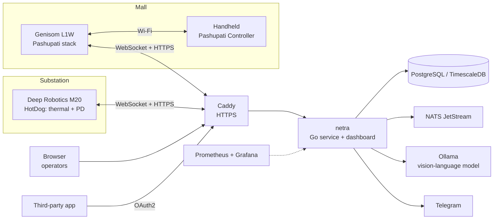

<div align="center">


# NETRA

**Patrol command center for EZRA Robotics' robots, in malls and in substations: the live fleet
on a floor plan, the robot's own map or a GPS site, patrols and schedules, AI anomaly detection,
substation thermal and partial discharge inspection rated after NETA, crowd analytics, reports and
an API for third-party applications. One application, licensed per client.**

[](https://github.com/DarmawanWeb/Netra/actions/workflows/validate.yml)
[](https://github.com/DarmawanWeb/netra-fleet-be/actions/workflows/ci.yml)
[](https://github.com/DarmawanWeb/netra-fleet-fe/actions/workflows/ci.yml)


[](LICENSE)

[Features](#features) · [System](#system) · [Install](#install-at-a-client) · [Run on a Mac](#run-on-a-mac) ·
[Deploy](#deploy-on-a-server) · [License](#license) · [Integration API](#integration-api) ·
[Documentation](#documentation) · [Develop](#develop)

</div>

---

Robots patrol on recorded routes: mall corridors, where they look for trash, spills and damage,
and substation yards, where they take thermal and acoustic captures of the equipment at their
stops. NETRA is where people watch them, start and schedule patrols, and decide what the robots
found. This repository is the **deployment root**: the infrastructure at the top level, the
application in two submodules.

## Features

**Monitor**
- Dashboard for the control room wall: today's figures, a live map with robot trails and follow
  mode, one queue of what needs attention now, the fleet with its controls, the activity log.
- Calibrated mall floor plan (SVG, PNG, JPG or PDF), or a metric grid in the robot's map frame
  until there is one. Robots, routes, anomalies and the crowd show on either.
- Robot health at a glance: battery, protective field, localization, CPU, GPU, RAM and
  temperature, with history charts and a replay of the track.

**Patrol**
- Start a patrol now, or on weekly and one-off schedules, on any route the robots recorded.
- Pause, resume, stop, localize, and a latched e-stop that only an explicit release lifts.
- Turn the robot's AI inspection and people detection on or off, and choose the model and its
  pace, from the browser.

**Anomalies**
- The robot's early detection is checked again by a larger vision-language model on the server.
- Per category: confirm at once and alert a Telegram group (trash to the cleaning crew), or wait
  for an operator to confirm or reject.

**Substation inspection**
- Equipment by bay as a single-line diagram, each piece in its condition; inspection points on the
  robots' routes with the camera pose and the regions to measure, drawn on the thermal image.
- Thermal readings rated after ANSI/NETA MTS Table 100.18 (against similar components and the
  ambient air) and partial discharge levels; findings from the first abnormal reading to resolved,
  with acknowledge, notes, trends and Telegram alerts.

**Analyse**
- Crowd heatmaps and hourly and daily peaks from the people the robots see.
- PDF and Excel reports per patrol and per period, in English or Indonesian.

**Integrate**
- Third-party applications read anomalies (with their original photos), robots, patrols, routes
  and floor plans over OAuth2 client credentials, with an OpenAPI description and Swagger UI.

**Operate**
- Roles (viewer, operator, supervisor, admin), an audit log of every change, login throttling.
- Runs on a VPS with HTTPS, or on a Mac on the robots' network for a demo or a site without
  internet; Prometheus and Grafana included, daily database backups.

## System



| Path | |
|---|---|
| [`be/`](https://github.com/DarmawanWeb/netra-fleet-be) | the `netra` service (Go); `netra-ai` (FastAPI), now optional |
| [`fe/`](https://github.com/DarmawanWeb/netra-fleet-fe) | the dashboard (Next.js static export, built into `netra`) |
| `Dockerfile` | the single image `netra`: the dashboard built into the service |
| `packaging/` | the installers: Linux `.deb` with systemd, Windows (Inno Setup, WinSW), macOS `.pkg` |
| `INSTALL.md`, `INSTALL.id.md` | the client's install guide |
| `docker-compose.yml` | the whole stack |
| `Caddyfile` | HTTPS, `/grafana` to Grafana, everything else to `netra` (API and dashboard) |
| `monitoring/` | Prometheus scrape config, Grafana datasources (Prometheus, TimescaleDB) and dashboard |
| `scripts/deploy.sh` | server: pull, update submodules, pull images, restart, pull the AI model |
| `scripts/dev.sh`, `dev/demo/`, `DEVELOPMENT.md` | development: hot reload, development licenses, simulated robots and demo data ([DEVELOPMENT.md](DEVELOPMENT.md)) |
| `docker-compose.local.yml`, `Caddyfile.local`, `.env.local.example`, `scripts/local.sh` | running on a Mac ([LOCAL.md](LOCAL.md)) |
| `docker-compose.tunnel.yml`, `Caddyfile.tunnel` | a Mac behind a Cloudflare Tunnel, LAN port kept for robots |
| `docs/` | [operator guide (PDF)](docs/NETRA-Panduan-Operator.pdf) and its LaTeX source |

The mall robots run [Pashupati](https://github.com/DarmawanRobotics/Pashupati), with the
handheld [Pashupati Controller](https://github.com/DarmawanRobotics/PashupatiController); the
substation robot runs [HotDog](https://github.com/DarmawanRobotics/HotDog).

## Install at a client

One application with its database, installed like any other program: the Windows installer, the
Ubuntu/Debian package or the macOS package of a [release](docs/release.md). The browser then opens
the setup (installation ID, administrator, license). Client guide: **[INSTALL.md](INSTALL.md)**
([Indonesian](INSTALL.id.md)); what EZRA hands over and how a license is activated:
[docs/client-kit.md](docs/client-kit.md).

## Run on a Mac

Robots on the same network as the Mac. See **[LOCAL.md](LOCAL.md)**:
`scripts/local.sh setup && scripts/local.sh up`, then `scripts/local.sh robot <id>` prints the
robot's connection settings. For a demo on a laptop, `scripts/local.sh export` on the server and
`scripts/local.sh import` on the laptop copy the data over, so robots keep their tokens and only
change `CC_URL` ([Demo: the command center on a laptop](LOCAL.md#demo-the-command-center-on-a-laptop)).

## Deploy on a server

```bash
git clone --recursive git@github.com:DarmawanWeb/Netra.git && cd Netra
cp .env.example .env            # domain, passwords, Telegram, AI model
cp ~/bekasi.lic license/netra.lic   # the client's license
docker compose up -d --build    # or with CI images: docker compose pull && docker compose up -d
docker compose exec ollama ollama pull qwen2.5vl:7b
```

Put the license in `license/netra.lic` ([License](#license)). Then open `https://<domain>`, log in
as `NETRA_ADMIN_USER`, add users (roles viewer, operator, supervisor, admin), register robots and
upload the floor plan. Grafana is at `/grafana`.

<details>
<summary><b>Updates, backups</b></summary>

Updates: `scripts/deploy.sh` (images from GHCR) or `scripts/deploy.sh --build`. The `deploy`
workflow runs it over SSH on `v*` tags (secrets `DEPLOY_HOST`, `DEPLOY_USER`, `DEPLOY_KEY`,
`DEPLOY_PATH`).

Backups: daily `pg_dump` into `backups/` (kept `BACKUP_KEEP_DAYS`); restore with
`docker compose exec -T db pg_restore -U netra -d netra --clean < backups/netra-YYYY-MM-DD.dump`.
Anomaly photos and floor plans are in the `api-data` volume.

</details>

## License

One NETRA for every client: the license of a deployment decides its **edition** (mall,
substation), its **tier** (basic, pro, enterprise), the **modules** (anomaly detection, crowd
analytics, substation inspection, report exports, Telegram alerts, audit log, server AI
verification, integration API, multi-site sync), the **robot limit** and the **branding** (name,
colours, logo). Put the license from EZRA Robotics in `license/netra.lic` and
`docker compose up -d api`, or install it in **Settings › License**
([license/README.md](license/README.md)). Without one, the core runs with one robot.

Updating a deployment from before licensing: install its license (a mall:
`-edition mall -tier enterprise`, or what the client bought) together with the update, or the
anomaly, crowd and other modules disappear until it is installed. How licenses are made:
[netra-fleet-be licensing](https://github.com/DarmawanWeb/netra-fleet-be/blob/main/docs/licensing.md).

## Integration API

Other systems read the anomalies (with their original photos), robots, patrols, routes and floor
plans over `https://<domain>/api/ext/v1`, with OAuth2 client credentials. An admin creates a client
in **Settings → API clients** (scopes; the secret is shown once) and gives the third party the
`client_id`, the `client_secret`, the guide
[INTEGRATION.md](https://github.com/DarmawanWeb/netra-fleet-be/blob/main/INTEGRATION.md) and the
interactive docs at `https://<domain>/api/ext/docs` (OpenAPI: `/api/ext/v1/openapi.yaml`).

## Documentation

| For | Document |
|---|---|
| Operators, security staff, supervisors | [Panduan Operator (PDF, Indonesian)](docs/NETRA-Panduan-Operator.pdf): safety, daily start with the Genisom L1W, dashboard, patrols, validation, schedules, routes, reports, troubleshooting |
| Running NETRA on a Mac | [LOCAL.md](LOCAL.md) |
| Developers: the working setup | [DEVELOPMENT.md](DEVELOPMENT.md): `scripts/dev.sh`, hot reload, development licenses, demo robots, VS Code |
| Backend developers | [netra-fleet-be/docs](https://github.com/DarmawanWeb/netra-fleet-be/tree/main/docs): architecture, dashboard API, database, licensing, configuration, development, AI service |
| Client administrators | [INSTALL.md](INSTALL.md) ([Indonesian](INSTALL.id.md)): install, first-time setup, license, robots, backups, updates, recovery |
| EZRA Robotics: delivery | [client kit](docs/client-kit.md): what a client gets, activation, renewal |
| EZRA Robotics: releases | [releasing](docs/release.md): the release workflow, installers, building by hand |
| Licenses (EZRA Robotics) | [licensing](https://github.com/DarmawanWeb/netra-fleet-be/blob/main/docs/licensing.md): editions, tiers, modules, signing key, issuing; [license/README.md](license/README.md) on a server |
| Dashboard developers | [netra-fleet-fe/docs](https://github.com/DarmawanWeb/netra-fleet-fe/tree/main/docs): architecture, development |
| Third-party integrators | [INTEGRATION.md](https://github.com/DarmawanWeb/netra-fleet-be/blob/main/INTEGRATION.md) and `/api/ext/docs` on the server |
| Robot side | [Pashupati](https://github.com/DarmawanRobotics/Pashupati) ([robot API](https://github.com/DarmawanRobotics/Pashupati/blob/main/src/robot_fleet/API.md)) |

## Develop

```bash
git clone --recurse-submodules git@github.com:DarmawanWeb/Netra.git && cd Netra
scripts/dev.sh setup && scripts/dev.sh up && scripts/dev.sh demo
code netra.code-workspace
```

The API reloads on save, the dashboard runs on `next dev`, and `scripts/dev.sh license <profile>`
switches between the editions, tiers and map modes (`gardu`, `mall`, `all`, `none`, ...) on the
fly. **[DEVELOPMENT.md](DEVELOPMENT.md)** covers the commands, licenses, demo data, VS Code,
branches and pull requests.

The `validate` workflow checks the compose files, the Caddyfiles and the shell scripts on pull
requests and on `main`; each submodule has its own CI (lint, tests, build) that publishes its
images to `ghcr.io/darmawanweb` on `main` and `v*` tags. `lefthook install` in the root and in each
submodule adds the same checks as Git hooks.

Released under the [Apache License 2.0](LICENSE).
