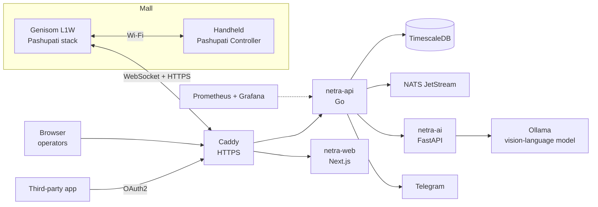

<div align="center">


# NETRA

**Patrol command center for Pashupati robots: the live fleet on the mall map, patrols and
schedules, AI anomaly detection with operator validation and Telegram alerts, crowd analytics,
reports, and a read-only API for third-party applications. By EZRA Robotics.**

[](https://github.com/DarmawanWeb/Netra/actions/workflows/validate.yml)
[](https://github.com/DarmawanWeb/netra-fleet-be/actions/workflows/ci.yml)
[](https://github.com/DarmawanWeb/netra-fleet-fe/actions/workflows/ci.yml)


[](LICENSE)

[Features](#features) · [System](#system) · [Run on a Mac](#run-on-a-mac) ·
[Deploy](#deploy-on-a-server) · [Integration API](#integration-api) · [Documentation](#documentation) ·
[Develop](#develop)

</div>

---

Robots patrol mall corridors on recorded routes and inspect the floor at their stop points. NETRA
is where people watch them, start and schedule patrols, and decide what the robots found. This
repository is the **deployment root**: the infrastructure at the top level, the application in two
submodules.

## Features

**Monitor**
- Dashboard for the control room wall: today's figures, a live map with robot trails and follow
  mode, one queue of what needs attention now, the fleet with its controls, the activity log.
- Calibrated mall floor plan (SVG, PNG, JPG or PDF), or a metric grid in the robot's map frame
  until there is one. Robots, routes, anomalies and the crowd show on either.
- Robot health at a glance: battery, protective field, localization, CPU, GPU, RAM and
  temperature, with history charts and a replay of the track.

**Patrol**
- Start a patrol now, or on weekly and one-off schedules, on any route the robots recorded.
- Pause, resume, stop, localize, and a latched e-stop that only an explicit release lifts.
- Turn the robot's AI inspection and people detection on or off, and choose the model and its
  pace, from the browser.

**Anomalies**
- The robot's early detection is checked again by a larger vision-language model on the server.
- Per category: confirm at once and alert a Telegram group (trash to the cleaning crew), or wait
  for an operator to confirm or reject.

**Analyse**
- Crowd heatmaps and hourly and daily peaks from the people the robots see.
- PDF and Excel reports per patrol and per period, in English or Indonesian.

**Integrate**
- Third-party applications read anomalies (with their original photos), robots, patrols, routes
  and floor plans over OAuth2 client credentials, with an OpenAPI description and Swagger UI.

**Operate**
- Roles (viewer, operator, supervisor, admin), an audit log of every change, login throttling.
- Runs on a VPS with HTTPS, or on a Mac on the robots' network for a demo or a site without
  internet; Prometheus and Grafana included, daily database backups.

## System



| Path | |
|---|---|
| [`be/`](https://github.com/DarmawanWeb/netra-fleet-be) | `netra-api` (Go) and `netra-ai` (FastAPI, vision-language model) |
| [`fe/`](https://github.com/DarmawanWeb/netra-fleet-fe) | `netra-web` (Next.js dashboard) |
| `docker-compose.yml` | the whole stack |
| `Caddyfile` | HTTPS, `/api` to the API, `/grafana` to Grafana, the rest to the dashboard |
| `monitoring/` | Prometheus scrape config, Grafana datasources (Prometheus, TimescaleDB) and dashboard |
| `scripts/deploy.sh` | server: pull, update submodules, pull images, restart, pull the AI model |
| `docker-compose.local.yml`, `Caddyfile.local`, `.env.local.example`, `scripts/local.sh` | running on a Mac ([LOCAL.md](LOCAL.md)) |
| `docker-compose.tunnel.yml`, `Caddyfile.tunnel` | a Mac behind a Cloudflare Tunnel, LAN port kept for robots |
| `docs/` | [operator guide (PDF)](docs/NETRA-Panduan-Operator.pdf) and its LaTeX source |

The robots run [Pashupati](https://github.com/DarmawanRobotics/Pashupati); the handheld is
[Pashupati Controller](https://github.com/DarmawanRobotics/PashupatiController).

## Run on a Mac

Robots on the same network as the Mac. See **[LOCAL.md](LOCAL.md)**:
`scripts/local.sh setup && scripts/local.sh up`, then `scripts/local.sh robot <id>` prints the
robot's connection settings. For a demo on a laptop, `scripts/local.sh export` on the server and
`scripts/local.sh import` on the laptop copy the data over, so robots keep their tokens and only
change `CC_URL` ([Demo: the command center on a laptop](LOCAL.md#demo-the-command-center-on-a-laptop)).

## Deploy on a server

```bash
git clone --recursive git@github.com:DarmawanWeb/Netra.git && cd Netra
cp .env.example .env            # domain, passwords, Telegram, AI model
docker compose up -d --build    # or with CI images: docker compose pull && docker compose up -d
docker compose exec ollama ollama pull qwen2.5vl:7b
```

Then open `https://<domain>`, log in as `NETRA_ADMIN_USER`, add users (roles viewer, operator,
supervisor, admin), register robots and upload the floor plan. Grafana is at `/grafana`.

<details>
<summary><b>Updates, backups</b></summary>

Updates: `scripts/deploy.sh` (images from GHCR) or `scripts/deploy.sh --build`. The `deploy`
workflow runs it over SSH on `v*` tags (secrets `DEPLOY_HOST`, `DEPLOY_USER`, `DEPLOY_KEY`,
`DEPLOY_PATH`).

Backups: daily `pg_dump` into `backups/` (kept `BACKUP_KEEP_DAYS`); restore with
`docker compose exec -T db pg_restore -U netra -d netra --clean < backups/netra-YYYY-MM-DD.dump`.
Anomaly photos and floor plans are in the `api-data` volume.

</details>

## Integration API

Other systems read the anomalies (with their original photos), robots, patrols, routes and floor
plans over `https://<domain>/api/ext/v1`, with OAuth2 client credentials. An admin creates a client
in **Settings → API clients** (scopes; the secret is shown once) and gives the third party the
`client_id`, the `client_secret`, the guide
[INTEGRATION.md](https://github.com/DarmawanWeb/netra-fleet-be/blob/main/INTEGRATION.md) and the
interactive docs at `https://<domain>/api/ext/docs` (OpenAPI: `/api/ext/v1/openapi.yaml`).

## Documentation

| For | Document |
|---|---|
| Operators, security staff, supervisors | [Panduan Operator (PDF, Indonesian)](docs/NETRA-Panduan-Operator.pdf): safety, daily start with the Genisom L1W, dashboard, patrols, validation, schedules, routes, reports, troubleshooting |
| Running NETRA on a Mac | [LOCAL.md](LOCAL.md) |
| Backend developers | [netra-fleet-be/docs](https://github.com/DarmawanWeb/netra-fleet-be/tree/main/docs): architecture, dashboard API, database, configuration, development, AI service |
| Dashboard developers | [netra-fleet-fe/docs](https://github.com/DarmawanWeb/netra-fleet-fe/tree/main/docs): architecture, development |
| Third-party integrators | [INTEGRATION.md](https://github.com/DarmawanWeb/netra-fleet-be/blob/main/INTEGRATION.md) and `/api/ext/docs` on the server |
| Robot side | [Pashupati](https://github.com/DarmawanRobotics/Pashupati) ([robot API](https://github.com/DarmawanRobotics/Pashupati/blob/main/src/robot_fleet/API.md)) |

## Develop

```bash
git submodule update --init --recursive
lefthook install          # in the root and in each submodule
```

The `validate` workflow checks the compose files, the Caddyfiles and the shell scripts on every
push; each submodule has its own CI (lint, tests, build) that publishes its images to
`ghcr.io/darmawanweb` on `main` and `v*` tags. See `be/README.md` and `fe/README.md`.

Released under the [Apache License 2.0](LICENSE).
